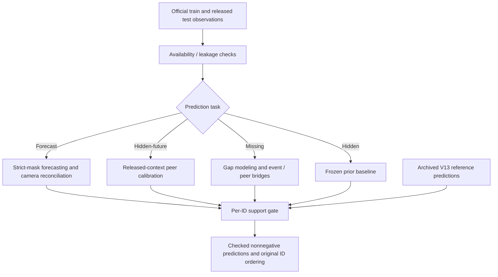

# Madinah Ethical AI — Multi-Camera Crowd Count Prediction

**Reproducible machine-learning research, forecasting, reconstruction, and leakage-aware validation.**

[Competition on Kaggle](https://www.kaggle.com/competitions/MDA-Ethical-AI-KAUST-Academy) · **Author: Mohammed Tariq** · **Research project / portfolio case study**

> [!IMPORTANT]
> This is an honest record of an exploratory competition project, **not a winning submission**. The best **public Kaggle score shown for the author was 0.729** (lower is better). The selected model's **0.6057000521183546 local score** was measured on reused development recordings with a reconstructed scoring reference. Those numbers are **not directly comparable** and the local result is **not an estimate of the private leaderboard**. No local or official score of 0.400 was established.

## Problem

Predict or reconstruct crowd counts from minute-level CCTV-derived *counts* across several cameras, under four different information-access constraints:

| Task | Goal | Time/data constraint |
|---|---|---|
| `forecast` | Predict count for upcoming minutes | Use only observations available at the supplied forecast origin (`now`) |
| `hidden-future` | Estimate unavailable camera measurements for future timestamps | Respect the forecast origin and hidden-camera availability |
| `hidden` | Reconstruct unseen camera observations | Use only officially released information; do not use hidden target counts |
| `missing` | Fill interior gaps in observed camera series | Use released context on both sides, when permitted by competition rules |

The official testing schema in the saved audit contained **4,457 target rows**: 2,660 forecast, 849 hidden, 484 hidden-future, and 464 missing. Of these, 644 targets belonged to cameras not represented in the historical train data, an important generalization limitation.

## Approach



The selected composite source lives at [`src/champion/`](src/champion/), exposing `candidate.predict_fold(train, released, targets, baseline)`. The archival validation runner expects an additional original `research_kit/input/benchmark.py` that is **not included in the available shared artifacts**. The production adapter at [`scripts/build_champion_production.py`](scripts/build_champion_production.py) is included and expects the **official CSVs plus an archived reference prediction file** supplied by the user. It does **not** submit to Kaggle.

## Key outcomes

| Measurement | Result and interpretation |
|---|---|
| Reused local evaluation | **0.6057000521183546**; replayed 3,719 matched labelled targets on Sept 11 and Sept 12, 2026 |
| Best displayed public Kaggle score | **0.729**; competition display rounds to three decimal places |
| Saved local causal checks | Two sampled cutoff perturbation checks passed for the selected composite; not an exhaustive proof |
| New-camera targets | **644** had no direct historical-camera support in the selected model |
| Later exploratory corrections | Several failed to generalize; the established champion was retained |

The reports under [`reports/`](reports/) are preserved as **historical experimental records**, including rejected experiments and earlier metrics; they should **not** be interpreted as one independent held-out benchmark. See [Limitations](docs/LIMITATIONS.md).

## Project layout

```text
src/champion/             Saved selected forecast / hidden / missing source
scripts/                  Production adapter and CSV validation helper
research/historical/      Older model development scripts (research archive)
research/late_stage/      V3.1–V3.4 hypothesis testing and diagnostics
research/validation_interfaces/
research/submission_experiments/
reports/champion/         Frozen result metadata and aggregate report JSON
reports/history/          Versioned research and validation write-ups
reports/late_stage/       Aggregate experiment findings (not raw labels)
docs/                     Project story, constraints, and publishing notes
data/                     Instructions only; official competition data excluded
```

## Reproducing the model on your own machine

**Python 3.12** is a reasonable starting point; original `__pycache__` files were not included. On Windows PowerShell:

```powershell
cd .\Madinah-Ethical-AI-Crowd-Prediction
py -3.12 -m venv .venv
.\.venv\Scripts\Activate.ps1
python -m pip install --upgrade pip
python -m pip install -r requirements.txt
```

1. Read and accept the rules for the [official Kaggle competition](https://www.kaggle.com/competitions/MDA-Ethical-AI-KAUST-Academy/rules). Download `train.csv`, `test.csv`, and `sample_submission.csv` **yourself**, placing them under `data/raw/` (which is gitignored).
2. Obtain your **own archived V13 production reference prediction CSV** and place it under `data/private/v13_reference.csv` (also gitignored). The public Kaggle sample submission is **not** a substitute for this model input.
3. Run the production adapter:

```powershell
python .\scripts\build_champion_production.py `
  --source .\src\champion `
  --train .\data\raw\train.csv `
  --test .\data\raw\test.csv `
  --sample .\data\raw\sample_submission.csv `
  --baseline .\data\private\v13_reference.csv `
  --output .\outputs\champion_reproduced.csv `
  --audit .\outputs\champion_reproduced_audit.json
```

Validate the file independently with:

```powershell
python .\scripts\validate_submission.py --sample .\data\raw\sample_submission.csv --submission .\outputs\champion_reproduced.csv
```

**No code in this repository uploads to Kaggle automatically.** Archived research modules are not a maintained package and may require additional private inputs, original folder layouts, or optional dependencies; see [`requirements-research.txt`](requirements-research.txt).

## Data permissions and privacy

This repository intentionally **does not redistribute official CCTV counts, train/test data, target labels, Kaggle credentials, or precomputed submission CSVs**. It uses the count-series problem definition; no video frames are stored. Check the competition's data and code-sharing terms before making any repository public. The existence of this package **does not imply a license to republish the dataset**. [See publishing notes](docs/PUBLISHING_AND_DATA.md).

## Reflections

A major lesson was the gap between repeatedly optimized local development folds and official public evaluation, and how stringent causal constraints, distribution shift, unseen cameras, and non-independent re-testing can affect generalization. The project prioritizes reproducible rejections and transparent reporting rather than claiming unverified results.

## License

**No software license has been selected for the user-provided research code.** Contact the author for permission to reuse; choose and add a license only after reviewing competition rules and third-party dependencies.

---

*This packaged repository contains source and documents **available in the shared conversation/file library**, not a complete filesystem snapshot of the author's local `Madinah-AI-Fresh` directory. Some original experiment scripts, dependency artifacts, baselines, and data are not available in this package.*
