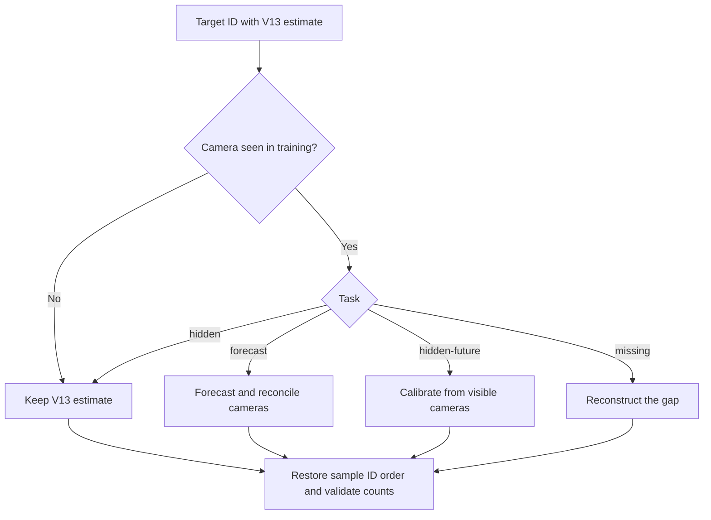

<div align="center">

# Madinah Ethical AI

**Multi-camera crowd count forecasting and reconstruction**

[](https://www.kaggle.com/competitions/MDA-Ethical-AI-KAUST-Academy)
[](requirements.txt)

[Model source](src/champion/candidate.py) · [Validation results](reports/champion/verified_rerun_validation.json) · [Run locally](#run-locally) · [Research notes](docs/PROJECT_STORY.md)

</div>

## The problem

A camera count is missing at 11:05. Its 11:06 reading can help reconstruct the gap. A forecast issued at 11:00 has to predict 11:05 using only what was known at 11:00. This distinction shaped how the model used every camera in the Madinah competition.

The inputs are minute-level crowd counts derived from CCTV. Each of the **4,457 target rows** specifies a camera, a time and one of four tasks.

| Task | Test targets | Matched local targets | How the selected model handles it |
| --- | ---: | ---: | --- |
| `forecast` | 2,660 | 2,036 | Forecast from observations through the supplied cutoff (`now`). Reconcile forecasts using historical relationships between cameras. |
| `hidden-future` | 484 | 482 | Estimate a hidden camera’s future count using visible cameras and calibration data available by the cutoff. |
| `hidden` | 849 | 843 | Keep the archived V13 estimate for each hidden observation. |
| `missing` | 464 | 358 | Fill gaps using released counts on either side, patterns from other cameras and the shape of similar historical events. |
| **Total** | **4,457** | **3,719** | |

## Results

| Evaluation | Score ↓ | What it measures |
| --- | ---: | --- |
| Best public Kaggle result for Mohammed Tariq | **0.729** | Best score displayed for the author on the public leaderboard, rounded to three decimals. |
| Selected model on local development recordings | **0.6057000521183546** | Replay of 3,719 matched targets from September 11–12, 2026, using a reconstructed scoring reference. |

Model selection reused both development recordings. The local and public scores measure different evaluations, so the local replay cannot establish a private leaderboard score or final rank. The project’s original 0.400 target remained unmet. [Validation limitations](docs/LIMITATIONS.md)

The per-task results explain why both recordings matter. Against the frozen baseline, the model reduced mean absolute error for `missing` on both Friday (**5.87 → 5.53** people) and Saturday (**4.22 → 3.99**). For `hidden-future`, it improved Friday (**3.57 → 3.45**) but worsened Saturday (**5.38 → 5.45**). Later experiments and their rejection decisions are part of the research record. [Per-recording results](reports/champion/verified_rerun_validation.json) · [Experiment decisions](reports/late_stage/)

## How predictions are assembled

The adapter starts with an archived V13 prediction for every target ID. **644 targets** come from cameras I–M, which were absent from the historical training set. The model keeps the reference estimate for those cameras.



The saved dry run produced **4,457 unique IDs** in official sample order, all with finite, nonnegative predictions. Two separate checks perturbed observations after a forecast cutoff. Across the 32 targets checked on Friday and 30 on Saturday, the largest prediction change was zero. Those checks cover one cutoff per recording. [Output audit](reports/champion/production_dry_run_audit.json) · [Cutoff checks](reports/champion/verified_rerun_validation.json)

## Run locally

The production adapter needs four input files. Three come from Kaggle. The fourth is the archived V13 production prediction file, which must be supplied separately.

| Location | Required input |
| --- | --- |
| `data/raw/` | Official `train.csv`, `test.csv` and `sample_submission.csv`. The sample defines the output IDs and row order. |
| `data/private/v13_reference.csv` | V13 predictions with columns `id,people` and one row per sample ID. The model uses these counts as its starting estimates. |

**1. Set up Python.** From the repository root in Windows PowerShell, create a virtual environment. Python 3.12 is a suggested starting version.

```powershell
py -3.12 -m venv .venv
.\.venv\Scripts\python.exe -m pip install -r requirements.txt
```

**2. Build the prediction CSV and audit.** Download the official files under the competition’s rules and place all four inputs at the paths above. Choose fresh output filenames for each run. [Competition data](https://www.kaggle.com/competitions/MDA-Ethical-AI-KAUST-Academy/data) · [Competition rules](https://www.kaggle.com/competitions/MDA-Ethical-AI-KAUST-Academy/rules)

```powershell
.\.venv\Scripts\python.exe .\scripts\build_champion_production.py `
  --source .\src\champion `
  --train .\data\raw\train.csv `
  --test .\data\raw\test.csv `
  --sample .\data\raw\sample_submission.csv `
  --baseline .\data\private\v13_reference.csv `
  --output .\outputs\champion_reproduced.csv `
  --audit .\outputs\champion_reproduced_audit.json
```

**3. Validate the output.** The checker verifies the columns, row count, ID order and prediction values. Both commands run locally. Uploading predictions to Kaggle is a separate manual step.

```powershell
.\.venv\Scripts\python.exe .\scripts\validate_submission.py `
  --sample .\data\raw\sample_submission.csv `
  --submission .\outputs\champion_reproduced.csv
```

## Research archive and reuse

The selected model exposes `candidate.predict_fold(train, released, targets, baseline)`. Replaying the original local evaluation also requires `research_kit/input/benchmark.py`, which is absent from this archive. Older experiments may depend on additional private inputs or their original directory layouts. [Selected source](src/champion/) · [Archived experiments](research/) · [Research dependencies](requirements-research.txt)

The repository contains code and aggregate research reports. Official data, target labels, video frames, credentials and prediction CSVs are excluded. The research code has no published software license. Contact the author about reuse. [Data and publishing notes](docs/PUBLISHING_AND_DATA.md)

**Mohammed Tariq** · [Portfolio](https://mohammed-tariq-portfolio.netlify.app/) · [GitHub](https://github.com/xmohamedtariq) · [LinkedIn](https://www.linkedin.com/in/mohammed-tariq-3a1a0824a/)
