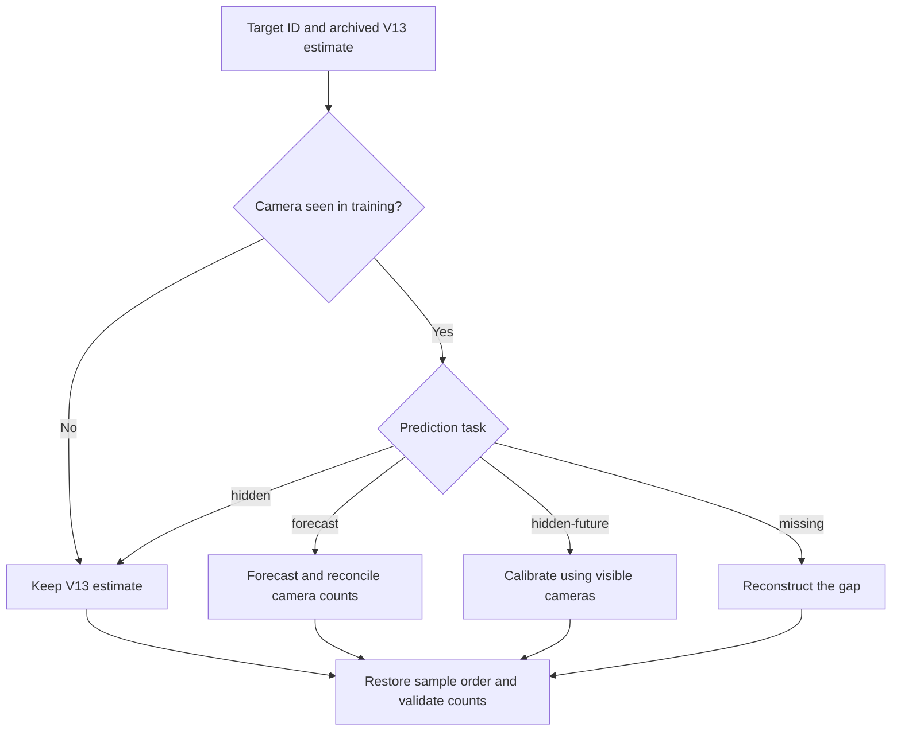

<div align="center">

# Madinah Ethical AI

**Multi-camera crowd count forecasting and reconstruction**

**Mohammed Tariq · Solo competitor · 89th out of 459 teams**

[](https://www.kaggle.com/competitions/MDA-Ethical-AI-KAUST-Academy/leaderboard)
[](https://www.kaggle.com/competitions/MDA-Ethical-AI-KAUST-Academy/leaderboard)

[Final standings](https://www.kaggle.com/competitions/MDA-Ethical-AI-KAUST-Academy/leaderboard) · [Model source](src/champion/candidate.py) · [Validation report](reports/champion/verified_rerun_validation.json) · [Run locally](#run-locally)

</div>

## Competition result

I competed individually in the **Madinah Ethical AI Competition** and finished **89th out of 459 ranked teams** on Kaggle’s final private leaderboard. That placed me **in the top 19.4% of the field**, with 88 teams ranked above me and 370 below.

| Final leaderboard detail | Result |
| --- | --- |
| Competitor | Mohammed Tariq |
| Participation | Individual |
| Final position | **89 / 459** |
| Final private score | **0.722** |
| Entries recorded by Kaggle | 34 |
| Share of test data used for the private leaderboard | Approximately 48% |

Kaggle ranked entries by score, with lower values indicating better performance. The final standings list **0.722** beside my name. My best recorded public score during the competition was **0.729**. The most recent submission, `Madinah_ShadowValidated_LastResort.csv`, received **0.740 public** and **0.782 private**. These last two scores belong to that specific file. [Official final leaderboard](https://www.kaggle.com/competitions/MDA-Ethical-AI-KAUST-Academy/leaderboard)

## The prediction problem

A camera is missing its crowd count at 11:05. If the task is to reconstruct a gap, the camera’s 11:06 reading can help. If the task is to forecast from 11:00, the model must make the same 11:05 prediction using only information available by 11:00.

The competition applied four such information constraints to minute-level crowd counts derived from CCTV cameras in Madinah. The official test contained **4,457 targets**. The local development replay covered **3,719 matched targets**.

| Task | Official targets | Local replay targets | Model approach |
| --- | ---: | ---: | --- |
| `forecast` | 2,660 | 2,036 | Forecast from observations available at the supplied origin (`now`) and reconcile estimates using historical relationships between cameras. |
| `hidden-future` | 484 | 482 | Estimate a hidden camera’s future count from visible cameras, using calibration data available by the forecast origin. |
| `hidden` | 849 | 843 | Retain the archived V13 estimate for the hidden observation. |
| `missing` | 464 | 358 | Reconstruct an interior gap using released counts on both sides, patterns from other cameras and similar historical events. |
| **Total** | **4,457** | **3,719** | |

## How the model handles unseen cameras

Five cameras, **I through M**, appeared in the test data but had no historical training observations. They accounted for **644 target rows**. For these cameras, the production adapter retained the archived V13 prediction. For cameras with training history, it selected the method according to the task.



The saved production run returned **4,457 unique IDs** in the official sample order. Every prediction was finite and nonnegative. The audit records how many predictions changed from V13 for each recording and task. [Production audit](reports/champion/production_dry_run_audit.json)

## What local validation showed

The selected model scored **0.605700** on the September 11–12, 2026 development recordings. Both recordings were reused during model selection, and the scoring reference was reconstructed locally. This score measures performance under that development protocol. The official result for the competition remains **89th place with a private score of 0.722**.

Breaking the local results down by recording shows where the changes helped. Values below are **mean absolute error in people**, with the frozen baseline shown first.

| Task | Friday, September 11 | Saturday, September 12 |
| --- | ---: | ---: |
| Reconstruct missing counts | 5.87 → **5.53** | 4.22 → **3.99** |
| Forecast hidden-camera counts | 3.57 → **3.45** | 5.38 → **5.45** |

Gap reconstruction improved on both recordings. Hidden-camera forecasting improved on Friday and worsened on Saturday. The archive preserves these mixed results alongside the experiments that were rejected. [Per-recording results](reports/champion/verified_rerun_validation.json) · [Experiment decisions](reports/late_stage/)

Two additional checks tested whether changing observations **after** a forecast cutoff affected predictions. The largest change was **zero** across 32 sampled Friday targets and 30 sampled Saturday targets. The checks covered one cutoff per recording. [Validation scope and limitations](docs/LIMITATIONS.md)

## Run locally

The production adapter requires the three official competition CSVs and a separate archived V13 prediction file.

| Path | Purpose |
| --- | --- |
| `data/raw/train.csv` | Historical camera counts |
| `data/raw/test.csv` | Released observations and prediction targets |
| `data/raw/sample_submission.csv` | Official target IDs and output order |
| `data/private/v13_reference.csv` | Archived V13 predictions with columns `id,people` and one row per target ID |

Download the official files through Kaggle after accepting the competition rules. Supply the archived V13 predictions separately. The sample submission provides the output format, while the V13 file provides the starting count for each target. [Competition data](https://www.kaggle.com/competitions/MDA-Ethical-AI-KAUST-Academy/data) · [Competition rules](https://www.kaggle.com/competitions/MDA-Ethical-AI-KAUST-Academy/rules)

### 1. Set up Python

From the repository root in Windows PowerShell, create a virtual environment. Python 3.12 is a suggested starting version.

```powershell
py -3.12 -m venv .venv
.\.venv\Scripts\python.exe -m pip install -r requirements.txt
```

### 2. Generate predictions and an audit

Use fresh output filenames for each run.

```powershell
.\.venv\Scripts\python.exe .\scripts\build_champion_production.py `
  --source .\src\champion `
  --train .\data\raw\train.csv `
  --test .\data\raw\test.csv `
  --sample .\data\raw\sample_submission.csv `
  --baseline .\data\private\v13_reference.csv `
  --output .\outputs\champion_reproduced.csv `
  --audit .\outputs\champion_reproduced_audit.json
```

### 3. Validate the prediction file

```powershell
.\.venv\Scripts\python.exe .\scripts\validate_submission.py `
  --sample .\data\raw\sample_submission.csv `
  --submission .\outputs\champion_reproduced.csv
```

The validator checks the column names, row count, unique IDs, sample order and prediction values. Both scripts run locally.

## Repository guide

| Location | Contents |
| --- | --- |
| [`src/champion/`](src/champion/) | Selected model and task-specific prediction methods |
| [`scripts/`](scripts/) | Production adapter and independent CSV validator |
| [`reports/champion/`](reports/champion/) | Frozen results, per-recording metrics and production audit |
| [`research/`](research/) | Historical models, validation interfaces and later experiments |
| [`reports/late_stage/`](reports/late_stage/) | Experiment comparisons and decisions |
| [`docs/PROJECT_STORY.md`](docs/PROJECT_STORY.md) | Engineering retrospective |
| [`docs/LIMITATIONS.md`](docs/LIMITATIONS.md) | Validation coverage and reproducibility limits |

The selected model exposes `candidate.predict_fold(train, released, targets, baseline)`. Replaying the original development evaluation also requires `research_kit/input/benchmark.py`, which is absent from this archive. Some earlier experiments require their original directory layouts or additional dependencies. [Research dependencies](requirements-research.txt)

## Data and reuse

This repository contains source code and aggregate research reports. Official competition data, target labels, video frames, credentials and precomputed submission CSVs are excluded. The research code has no published software license. Contact the author about reuse. [Data and publishing notes](docs/PUBLISHING_AND_DATA.md)

## Author

**Mohammed Tariq**  
AI Solutions Developer · Machine Learning & Data Analytics

[Portfolio](https://mohammed-tariq-portfolio.netlify.app/) · [GitHub](https://github.com/xmohamedtariq) · [LinkedIn](https://www.linkedin.com/in/mohammed-tariq-3a1a0824a/)
